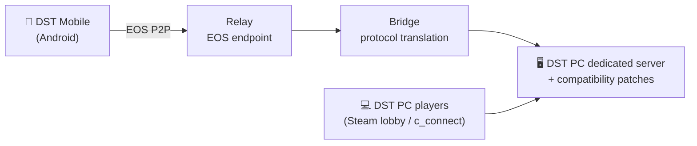

# DST Crossplay: Mobile ↔ PC

Play **Don't Starve Together** in one world across **PC (Steam)** and **Mobile (Android)**.

A stock, non-rooted phone joins a patched PC dedicated server straight from the in-game **Browse Games**
list, and PC players join the same world the usual way. Seeing each other, chat, fighting bosses, dying and
being revived all work, and phones go down into the Caves and back up like PC players.

**English** · [Tiếng Việt](#tiếng-việt) · [中文](#中文)

## Try it now (no install)

1. Open DST on your Android phone → **Browse Games**
2. Search `DST Crossplay PC Mobile`, pick a server
3. Enter the password announced in `#how-to-join` on [Discord](https://discord.gg/DFnPkmHwTE)

Nothing is installed or modified on the phone.

## How it works

- **Server:** a standard PC dedicated server with a few small binary patches so it accepts a mobile
  client's identity. The repository ships **none of Klei's files** — you bring your own copy.
- **Bridge:** translates the differences between the two protocols (handshake, server listing,
  entity/netvar tables, a few RPC ids) in both directions.
- **Relay:** mobile clients connect through Epic Online Services (EOS) instead of to an IP address; the
  relay is the EOS endpoint in front of the bridge.

Everything runs with Docker on a single Linux x86_64 machine.

## Host your own server

👉 **[deploy/crossplay-docker/](deploy/crossplay-docker/)** — one folder, one `.env`, one Docker command.

You must supply a few licensed/account-bound inputs yourself (the EOS SDK, EOS credentials, a Klei cluster
token, and the dedicated server build); see
[`deploy/crossplay-docker/vendor/README.md`](deploy/crossplay-docker/vendor/README.md). The repository
contains no game binaries, assets, scripts, credentials or tokens.

## Status

| Milestone | Status |
| :--- | :--- |
| Network protocol analysis of the mobile and PC builds | ✅ |
| Bridge + relay between the mobile client and a PC dedicated server | ✅ |
| A phone joins a PC dedicated world and plays | ✅ |
| PC and Mobile players in the same online server | ✅ (Linux Docker stack) |
| One-machine Docker self-host | ✅ |
| Caves: phones go down and back up | ✅ (online servers, both directions) |
| Native Windows host | 🚧 partial (phone join still needs more patches) |
| Server-side mods on mobile | 🔜 next wave |

## Known limitations

- Tied to one specific PC server build; a game update needs the translation tables refreshed.
- Players join with default cosmetics (skins are not carried over).
- Client mods can't run on the phone; server-side mods are being tested separately.
- iOS is untested.

## Contributing

Bug reports, test results from different phones, and ideas are welcome: open an
[issue](https://github.com/dinhkarate/dst-crossplay-mobile-pc/issues) or post in `#bug-reports` on Discord.
Please remove personal information (account names, IP addresses, tokens) from logs and screenshots.

## License

[GNU AGPL-3.0](LICENSE). If you run a modified version of this software as a network service, you must offer
its source to your users. See [NOTICE](NOTICE): this repo ships no Klei/Epic assets, binaries, credentials
or tokens — you supply those yourself from sources you are licensed to use.

---

## Tiếng Việt

Dự án giúp người chơi **Don't Starve Together** trên **PC (Steam)** và **Mobile (Android)** vào chung một thế
giới. Điện thoại **không root, không mod APK**, vào thẳng từ mục **Browse Games** như bình thường; người chơi
PC vào cùng thế giới đó. Thấy nhau, chat, đánh boss, chết và hồi sinh, xuống Caves rồi lên lại đều chạy.

- **Thử ngay:** mở DST trên điện thoại → Browse Games → tìm `DST Crossplay PC Mobile`, nhập mật khẩu (công bố
  ở `#how-to-join` trên [Discord](https://discord.gg/DFnPkmHwTE)).
- **Tự dựng server:** xem [`deploy/crossplay-docker/`](deploy/crossplay-docker/) — một thư mục, một file
  `.env`, một lệnh Docker. Bạn phải tự cung cấp vài thứ có bản quyền/gắn tài khoản (EOS SDK, credential EOS,
  cluster token, bản dedicated server); repo không chứa file, asset, script, credential hay token nào của game.

Dự án phi thương mại do fan làm, không liên kết với Klei hay Playdigious. Giấy phép [AGPL-3.0](LICENSE).

## 中文

本项目让 **PC（Steam）** 和 **手机（Android）** 上的 **饥荒联机版（Don't Starve Together）** 玩家进入同一个世界。
无需 root、无需修改 APK，手机直接从游戏内 **Browse Games** 列表加入；PC 玩家照常加入同一世界。互相可见、聊天、
打 Boss、死亡与复活、进出洞穴均可用。

- **立即体验：** 手机打开 DST → Browse Games → 搜索 `DST Crossplay PC Mobile`，输入密码（见 [Discord](https://discord.gg/DFnPkmHwTE) 的 `#how-to-join`）。
- **自建服务器：** 见 [`deploy/crossplay-docker/`](deploy/crossplay-docker/)。仓库不包含任何游戏文件、资源、脚本、
  凭据或令牌；EOS SDK、EOS 凭据、cluster token 和专用服务器需自行准备。

非商业粉丝项目，与 Klei、Playdigious 无关。许可证 [AGPL-3.0](LICENSE)。

---

*Fan-made project, not affiliated with or endorsed by Klei Entertainment or Playdigious. Don't Starve
Together is a trademark of Klei Entertainment. You need your own legitimate copy of the game.*
